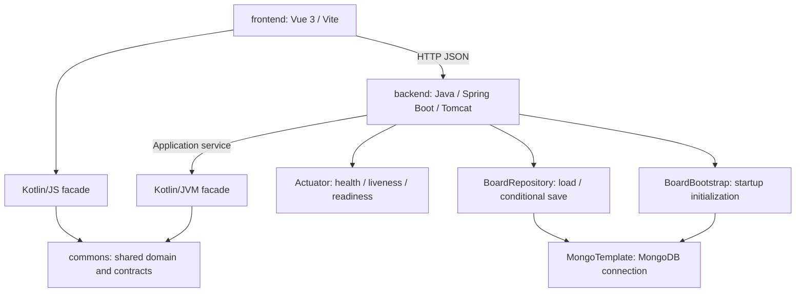
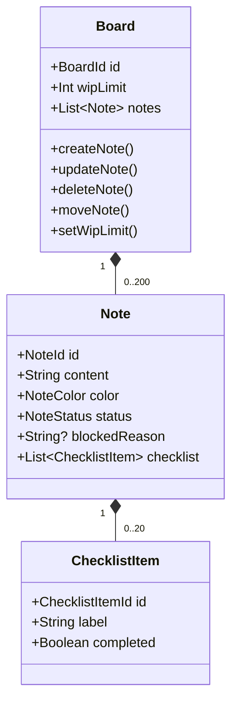
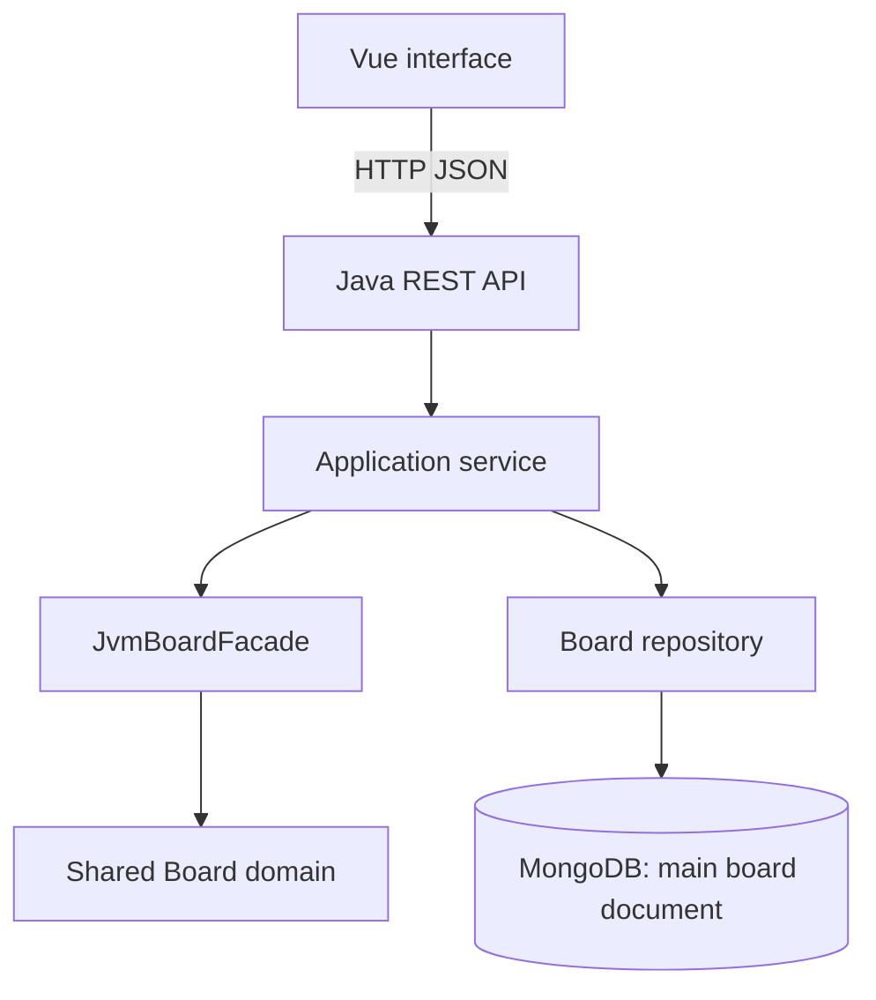
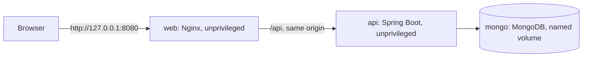

<!-- SPDX-License-Identifier: MIT -->
<!-- SPDX-FileCopyrightText: 2026 Lorenzo Tosi, Alessandro Stefani -->

# System Architecture and Domain Boundaries

The system consists of three Gradle modules: a shared Kotlin domain, a Java/Spring Boot backend, and a Vue frontend. Domain rules are written once and consumed from both runtimes.

## 1. Current architecture

- `commons` contains the Kotlin Multiplatform domain, commands, snapshots, serialization, and the JVM/JavaScript facades.
- `frontend` provides the Kanban app. It loads snapshots, submits HTTP commands, and uses the Kotlin/JS facade for client prevalidation. A revision conflict reloads the board without resubmitting the command.
- `backend` is a Java/Spring Boot application using Spring Web MVC and embedded Tomcat. Controllers delegate to `BoardServiceImpl`, which loads the board, executes the shared JVM command, and conditionally saves the resulting snapshot.
- `MongoBoardRepository` stores the complete board in the `boards` collection as one document (`_id="main"`). `BoardDocumentMapper` validates snapshots through the shared domain before loading or saving.
- `MainTest` starts the server and checks HTTP liveness without a reachable database. `DomainInteropTest` checks Java consumption of the JVM facade.
- HTTP JSON uses Jackson. The shared domain keeps its own serialization for JVM/JS commands and snapshots.

Dependencies point inward. Framework and persistence code may depend on `commons`. `commons` depends on no web, database, or UI framework.

## 2. Implemented domain aggregate

The board rules live in one bounded context. `Board` is the sole aggregate root and owns `Note` entities and their `ChecklistItem` values.

All state changes pass through the aggregate. A note's position is its index inside the board's ordered collection, not an independent coordinate. This keeps WIP limits, ordering, blockers, checklist completion, capacities, and transition rules consistent across JVM and browser runtimes.

## 3. HTTP application boundary

REST controllers and an application service connect the shared domain to the persistence adapter:

`BoardService` declares note creation, editing, deletion, movement, WIP, blocker, and checklist operations. Every mutation accepts `expectedRevision` and returns the saved `BoardSnapshot`. A revision mismatch returns `409 REVISION_CONFLICT`. Controllers map HTTP requests to these methods and translate domain errors to the codes in [API contracts](contracts.md).

## 4. Concurrency boundary

`MongoBoardRepository.save(updated, expectedRevision)` validates the candidate state and performs one replacement filtered by `_id="main"` and `revision=expectedRevision`. The replacement stores `expectedRevision + 1`, uses no upsert, requires an acknowledged write, and returns an empty result when no document matches. This is a single-document compare-and-swap boundary without multi-document transactions.

The application service connects this boundary to each mutating request. A failed match reloads the current revision and raises `REVISION_CONFLICT`. It does not replay the command or retry the save. See [concurrent commands](concurrency.md) and [API contracts](contracts.md#3-server-side-validation-precedence-order).

## 5. Runtime topology

The delivery runtime is defined by `compose.yaml` and described in [deployment](deployment.md#delivery-stack):

The browser reaches only the web container. Nginx forwards requests under `/api` to the API container. The app and the API therefore share one origin. No CORS configuration exists. The API and MongoDB publish no host port. The board lives in the named volume `mongo-data`.

The containers run the images produced by the build: the API image carries the verified JAR, the web image carries the Vue bundle and the Nginx configuration. The runtime needs neither a JDK, nor Node.js, nor a source checkout.

The development override publishes the API and MongoDB ports on loopback. The Vite development server serves the app and proxies `/api` to the API container. The single origin is therefore a property of the delivery runtime, not of the development stack.
