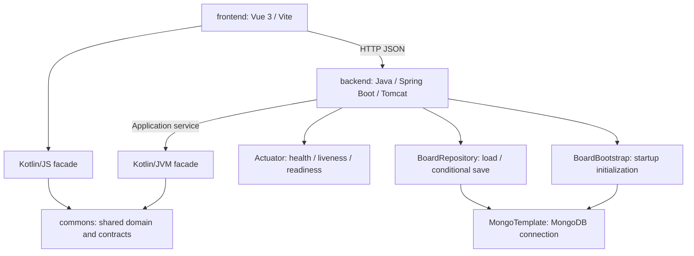
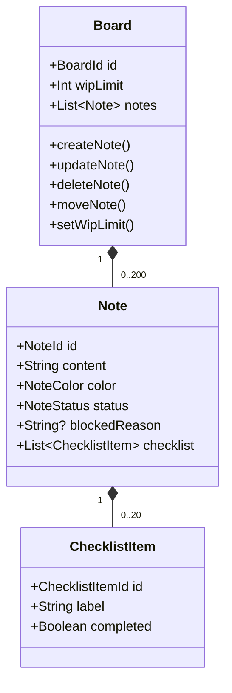
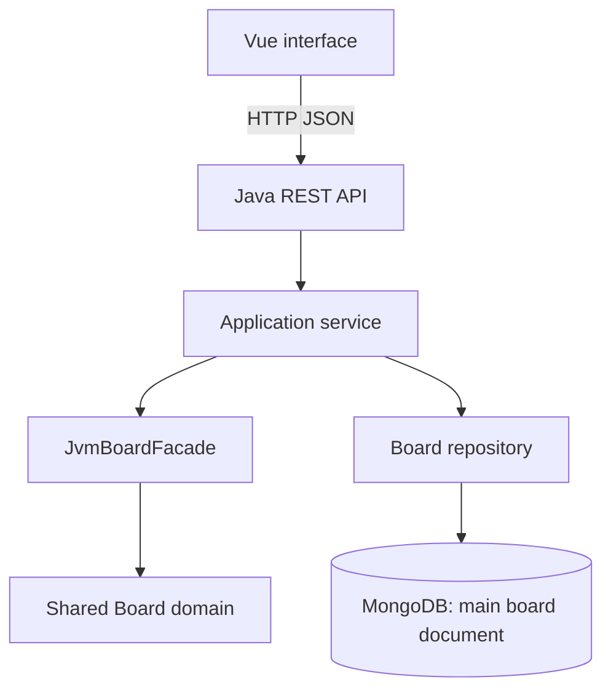
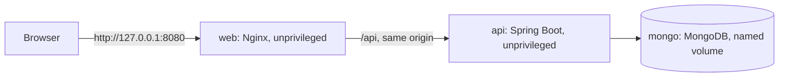

<!-- SPDX-License-Identifier: MIT -->
<!-- SPDX-FileCopyrightText: 2026 Lorenzo Tosi, Alessandro Stefani -->

# System Architecture and Domain Boundaries

This document separates the architecture implemented today from the planned runtime architecture.

## 1. Current architecture

The implemented system consists of three Gradle modules:

- `commons` contains the Kotlin Multiplatform domain, commands, snapshots, serialization, and JVM/JavaScript facades.
- `frontend` provides the Kanban interface. `App.vue` uses `useBoard` and `boardClient` to load snapshots and submit HTTP commands. The Kotlin/JS facade performs client prevalidation; successful server responses replace the displayed board. On a revision conflict, the client reloads the board without automatically resubmitting the command. MongoDB holds the persistent state.
- `backend` is a Java/Spring Boot application using Spring Web MVC and embedded Tomcat. Actuator exposes health endpoints; `MainTest` starts the server and verifies HTTP liveness without a reachable database. `DomainInteropTest` verifies Java consumption of the JVM facade.
- The backend uses Jackson for HTTP JSON. The server converter customization in `Main` removes the auto-detected Kotlin Serialization JSON converter, so snapshots retain all required fields both as direct responses and inside Java response records. Shared-domain JSON serialization remains in `commons`.
- The Jackson configuration in `Main` rejects unknown command fields and scalar coercions. Note creation and updates treat null optional fields as omitted: creation defaults to yellow, and PATCH leaves them unchanged. Checklist requests retain their existing JSON creators and reject explicit null. Controllers reject missing or negative revisions before loading the board.
- `ApiExceptionHandler` logs server failures with the error code and HTTP status, plus exception type for unexpected errors. Logs use the standard Spring Boot console format and omit exception details and request data.
  MongoDB driver INFO diagnostics and health-check warning traces are suppressed to keep connection credential metadata out of these default logs.
- `CommandBodyLimitFilter` bounds POST, PUT, PATCH, and DELETE bodies under `/api` before controller dispatch. It reads at most 65,537 bytes and rejects bodies above 65,536 bytes with the standard API error shape. Accepted bodies are replayed from the bounded buffer to the JSON converter. This covers chunked requests without trusting `Content-Length` and prevents a command from mutating the board before the complete body is checked.
- `ChecklistController` maps checklist creation, partial updates, and deletion to the corresponding `BoardService` methods. Java records carry the request fields and the creation response. The controller returns the saved board and, for creation, the ID of the appended item on the target note. Checklist rules remain in the shared domain; see the [R3 checklist endpoints](contracts.md#4-checklist-endpoints-r3).
- Spring Data MongoDB configures a client from an environment-backed connection URI. The `local` and `test` profiles define local binding and test defaults; see [local development](development.md#backend-runtime).
- `MongoBoardRepository` loads and conditionally replaces the complete board in the `boards` collection. `BoardDocument` separates the persisted representation from Kotlin snapshots; `BoardDocumentMapper` validates snapshots through the shared domain before loading or saving. Missing boards produce an empty load result, invalid persisted state propagates unchanged, and Spring Data failures become repository-level `IllegalStateException`s. See [persistence unit tests](testing.md#backend-persistence-unit-tests).
- `BoardServiceImpl` coordinates all note, movement, WIP, blocker, and checklist commands. It loads the board, checks the caller's expected revision, generates UUIDs for new notes or items, executes the shared JVM command, and conditionally saves the resulting snapshot. Domain rejections raise `BoardServiceException` with the original code and optional field without saving. Revision conflicts include `currentRevision`; an unmatched save triggers one read to obtain that revision without replaying the command or retrying the save. If the board disappeared, the conflict revision is unavailable. The service rejects revision overflow before calling the repository's save method and translates invalid persisted state to `INVALID_SNAPSHOT` and database failures to `DATABASE_UNAVAILABLE`. An initially missing board raises a runtime error without creating it. The service is exercised by [unit tests](testing.md#backend-application-service-unit-tests) and the [HTTP/MongoDB suite](testing.md#checklist-http-and-mongodb-integration-tests-r3).
- `BoardBootstrap` is a Spring Boot `ApplicationRunner`. On startup, it attempts an acknowledged upsert filtered only by `_id="main"`, with `$setOnInsert` for schema version `1`, revision `0`, WIP limit `3`, and an empty notes list. Existing documents are unchanged, including their revision and any invalid state; validation occurs when the repository loads them. A duplicate key from concurrent initialization is tolerated without a reset or retry. A MongoDB resource failure or translated operation timeout produces a warning and allows startup; initialization must be retried by restarting the backend after recovery. Other database errors and unacknowledged writes fail initialization.

`GET /actuator/health/liveness` reports application liveness independently of MongoDB. The aggregate `GET /actuator/health` includes MongoDB connectivity; the readiness group includes both application readiness and the MongoDB indicator. Health details are not exposed. `MongoConfiguration` customizes the auto-configured MongoDB client after the connection URI is applied, setting five-second server-selection, connection, and operation timeouts.

## 2. Implemented domain aggregate

The Kanban workflow is encapsulated inside one bounded context. `Board` is the sole aggregate root and owns `Note` entities and their `ChecklistItem` values.

All state changes pass through the aggregate. This keeps WIP limits, ordering, blockers, checklist completion, capacities, and transition rules consistent across JVM and browser runtimes. A note's canonical position is its index inside the board's ordered collection, not an independent coordinate.

## 3. HTTP application boundary (R2)

REST controllers and an application service connect the shared domain to the persistence adapter:

`BoardService` declares methods for note creation, editing, deletion, movement, WIP changes, blockers, and checklist operations. Every mutation accepts `expectedRevision` and returns the saved `BoardSnapshot`. For `updateNote` and `updateItem`, nullable parameters represent values left unchanged; checklist completion uses Java `Boolean` so an omitted value remains distinct from `false`. REST controllers delegate these operations to `BoardServiceImpl`.

The dependency direction remains inward: framework and persistence code may depend on the shared domain, while `commons` must not depend on web, database, or UI frameworks.

## 4. Concurrency boundary

`MongoBoardRepository.save(updated, expectedRevision)` requires the snapshot revision to match the non-negative expected revision. It checks for integer overflow, validates the candidate state, and performs one replacement filtered by `_id="main"` and `revision=expectedRevision`. The replacement stores revision `expectedRevision + 1` and uses no upsert. The repository requires an acknowledged write, returns the saved snapshot on a match, and returns an empty result on no match without retrying. This provides a single-document compare-and-swap boundary without multi-document transactions.

The application service and REST endpoints connect this boundary to each mutating request's expected revision and return `409 REVISION_CONFLICT` when the stored revision does not match.

The accepted rationale and trade-offs are recorded in [ADR 001](adr/001-board-aggregate.md) and [ADR 002](adr/002-local-scope.md).

## 5. Runtime topology

The delivery runtime is defined by `compose.yaml` and described in [deployment](deployment.md#delivery-stack):

The browser reaches only the web container. Nginx forwards the requests under `/api` to the API container keeping the prefix, so the interface and the API share one origin and no CORS configuration exists. The API and MongoDB publish no host port: they are reachable only from the other containers of the stack. The board document lives in the named volume `mongo-data`.

The containers run the images produced by the build: the API image carries the verified JAR, the web image carries the Vite bundle and the Nginx configuration. The stack references those images by name and never builds them, so the runtime needs neither a JDK, nor Node.js, nor a source checkout.
